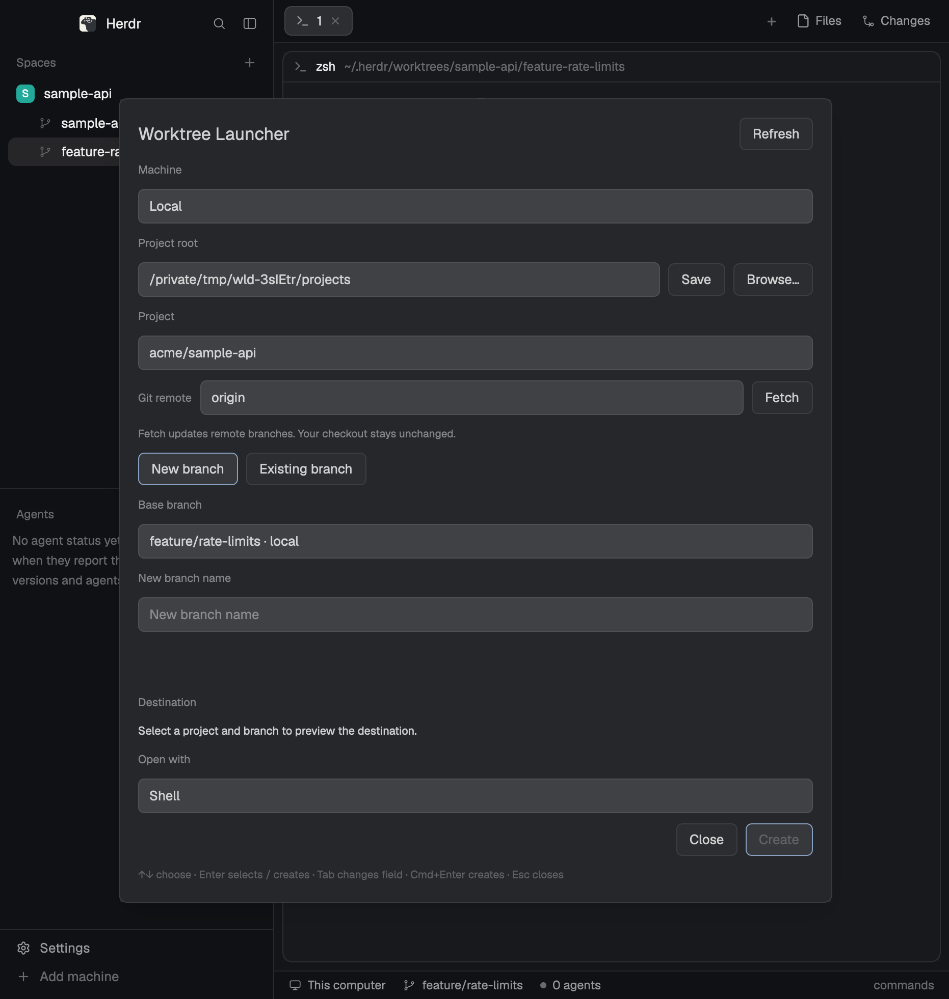
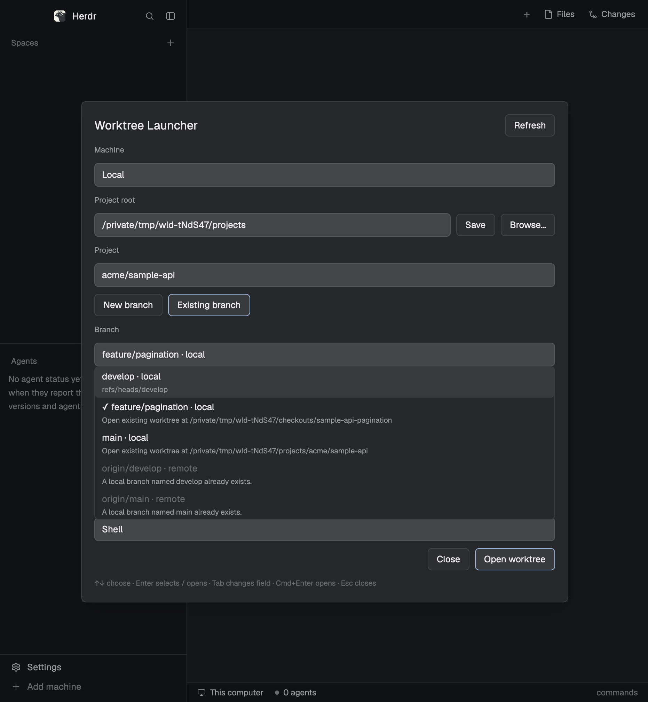
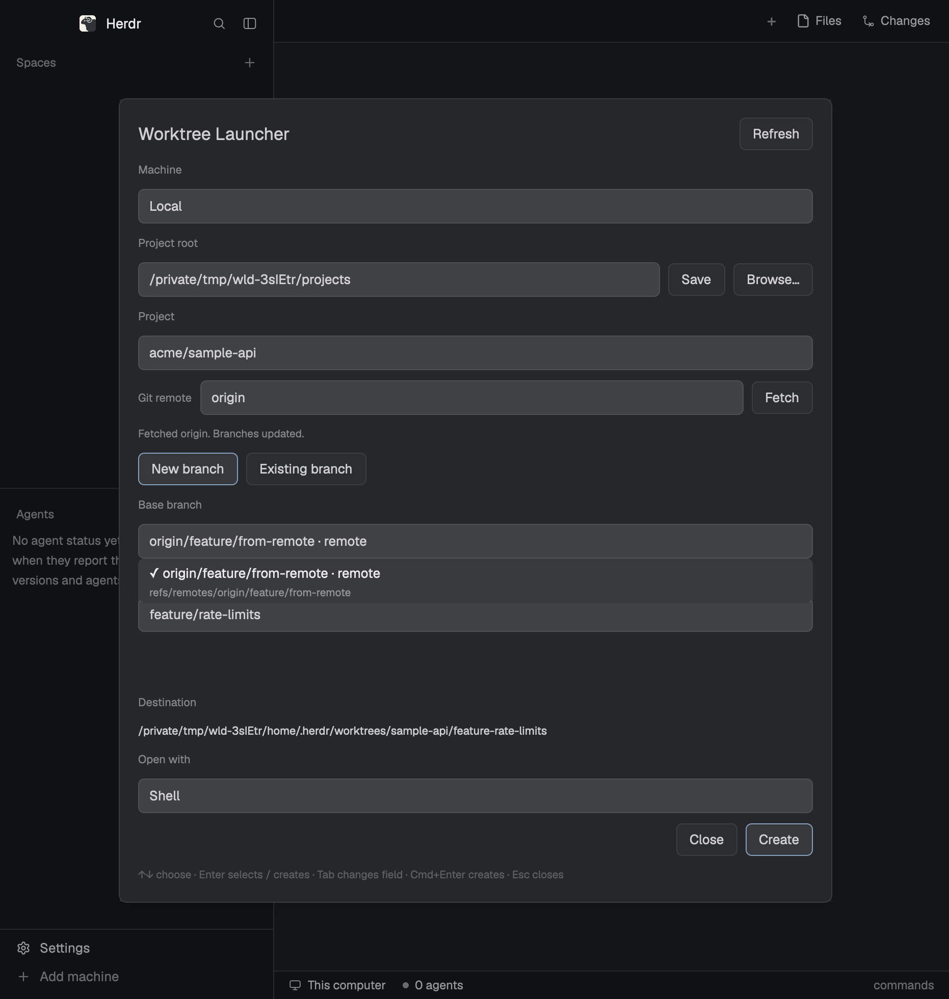
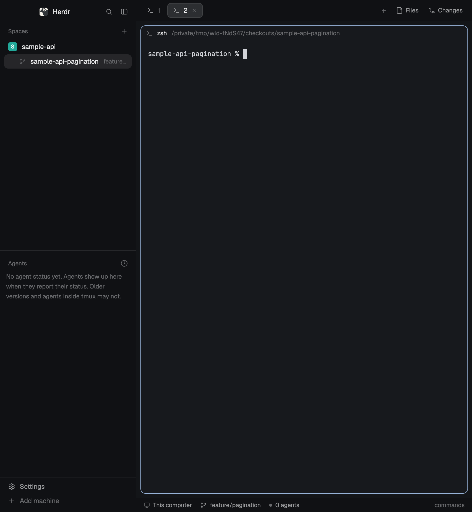
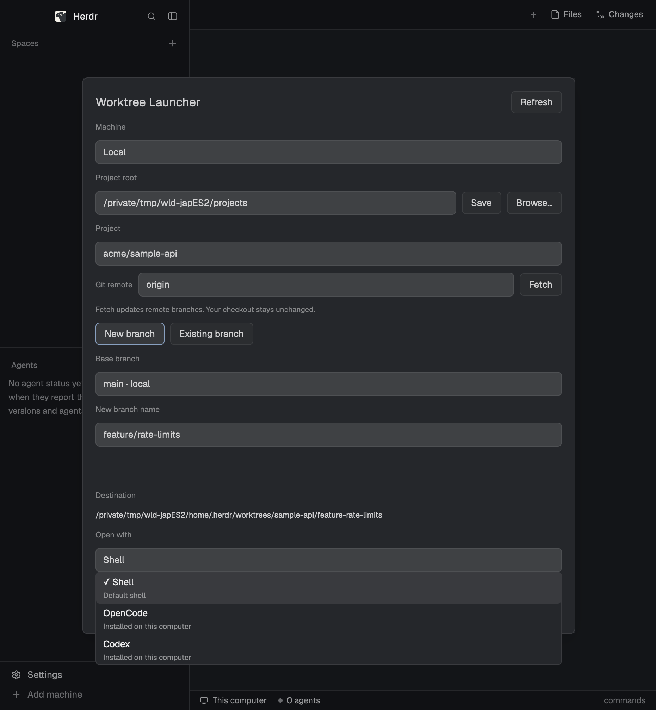
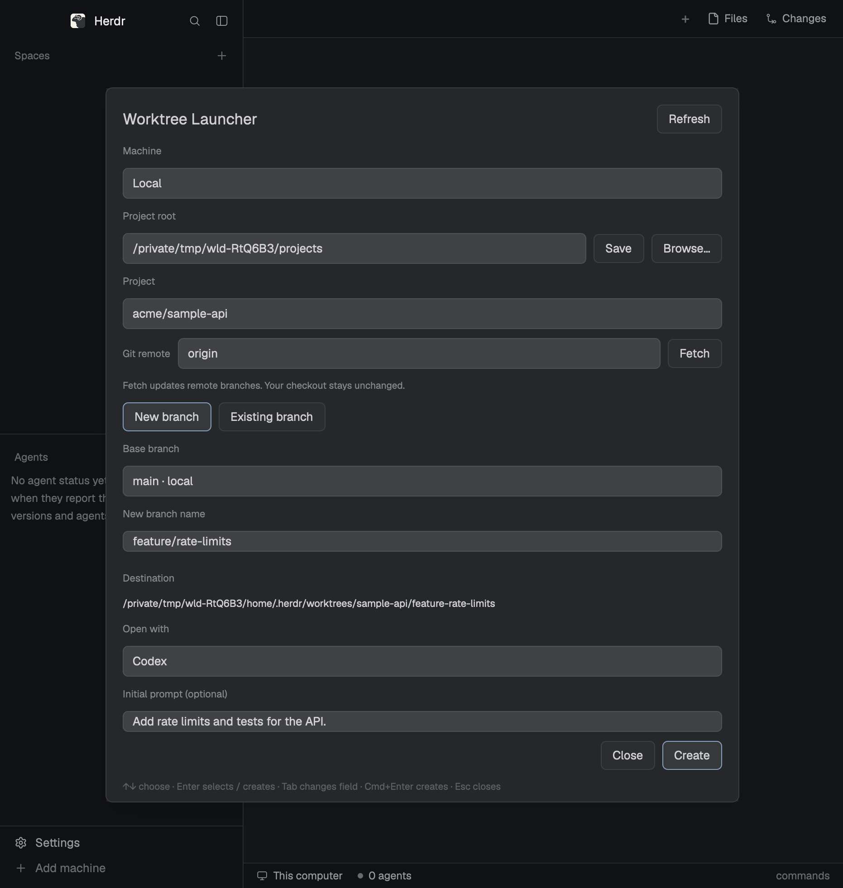

# Worktree Launcher

Create Git worktrees or start a fresh Herdr session from the desktop launcher or a terminal.

Choose a project, select a branch, and open a shell or coding agent. Your primary checkout stays intact.

Start with the [desktop installation](#install-the-desktop-launcher) and [first-worktree guide](#create-your-first-worktree), or use the [standalone CLI](#use-the-terminal-cli).

## Features

| Feature | What you can do |
| --- | --- |
| New branches | Select a local or fetched remote base and create a separate worktree. |
| Current-space defaults | Start with the active space's project and checked-out branch, then change either selection as needed. |
| Existing branches | Create a checkout for an available branch, or use its existing worktree folder. |
| Fetch remote branches | Fetch `origin` or another Git remote, then select new or updated branches without leaving the launcher. |
| Fresh sessions | Detect the worktree's existing Herdr space and open a new tab, or create a space. |
| Shells and agents | Start Shell, Claude Code, Pi, OpenCode, or Codex. Only installed agents appear; give an agent an optional initial prompt. |
| Local and remote projects | Browse project folders and save a separate project root for each connected machine. |
| Native Herdr workflow | Keep worktrees grouped beneath their project, use keyboard controls, and follow Herdr's light or dark theme. |
| Terminal CLI | Infer the current checkout and branch, or specify them explicitly. Works from a mobile terminal. |
| Dry-run previews | Validate a CLI command and inspect its destination and session plan before creation. Text and JSON output are available. |
| Agent automation | Use explicit commands, JSON results, `--help`, and bundled `--skill` instructions. Attach to the new terminal with `--attach`. |
| Retry failed openings | Keep a created checkout and retry session startup. Unrelated projects and machines remain usable. |

If a created worktree's session fails to open, you can retry opening it without repeating Git creation.

## Install the desktop launcher

You need:

- Herdr for macOS, with `herdr-app` and `hc` available in your terminal.
- Git, [Worktrunk](https://worktrunk.dev/) (`wt`), `hc`, and `herdr-worktree-launcher` on each target machine.
- Go for building the CLI. Node.js 24 or newer and pnpm 11.x for installing the desktop mod.

Download or clone this repository. In your terminal, change into its directory, then run:

```sh
./scripts/install-cli.sh
pnpm run install:mod
```

The installer copies the mod, checks it with your installed Herdr, and adds **⌘⇧G** (Command+Shift+G). It preserves existing settings and keybindings.

Avoid editing project roots or keybindings while the installer runs. It checks for changed files, but the check and write are separate: concurrent edits to existing settings files can still be overwritten. New files use exclusive creation, and existing keybindings are backed up before a shortcut change.

A dependency installation with `pnpm install` is not required.

For prebuilt CLI archives and checksum instructions, see [Install a package](docs/packages.md). A prebuilt CLI needs no Go installation.

If that shortcut is already assigned, use `pnpm run install:mod --no-shortcut`. You can open the launcher from your terminal:

```sh
herdr-app do mod.open --name worktree-launcher
```

The installed mod calls the CLI on the selected machine. It needs no Node process or additional mod. The sample workflow was checked with Herdr app 0.1.15 and core 0.1.20.

### Choose a different shortcut

1. Open Herdr's `keys.json`, normally at `~/.config/herdr-app/keys.json`.
2. In `global`, add an unused key combination, such as **⌘⌥G** (Command+Option+G):

   ```json
   {
     "global": {
       "cmd-alt-g": "mod.open:worktree-launcher"
     }
   }
   ```

   Merge this entry into the existing `global` object. Keep the other bindings and sections.

3. If present, remove the old `"cmd-shift-g": "mod.open:worktree-launcher"` entry to replace the default shortcut.
4. Save the file, then press your new shortcut.

Herdr applies keybinding changes immediately. No restart is necessary. If you set `HERDR_APP_HOME`, edit `keys.json` in that directory instead.

Key names use `cmd`, `ctrl`, `alt` (Option), and `shift`, joined with hyphens. Bindings in `terminal` or `layout:<name>` override the same combination in `global`.

To install without the default shortcut, use `pnpm run install:mod --no-shortcut`. For later updates, use:

```sh
pnpm run install:mod --no-shortcut
```

This preserves your custom binding and prevents the installer from adding **⌘⇧G** again.

## Use the terminal CLI

`herdr-worktree-launcher` runs on Linux and macOS. It needs Git, [Worktrunk](https://worktrunk.dev/) (`wt`), and `hc` on that machine.

The installed command is a standalone executable. It needs no Node, Bun, pnpm, or npm packages. The desktop app can stay closed.

To build and install from this repository, install [Go](https://go.dev/doc/install), then run:

```sh
./scripts/install-cli.sh
```

Go is a build tool only. The CLI uses the Go standard library without third-party Go modules. The script installs one executable at `~/.local/bin/herdr-worktree-launcher`. Add `~/.local/bin` to your `PATH` if necessary. You can also use `pnpm run install:cli`; no dependency installation is required.

The repository includes `mise.toml` for Go and Worktrunk. If you use [mise](https://mise.jdx.dev/), run `mise install` first. Keep `wt` on the runtime `PATH`; the launcher reports a clear error if it is missing. Herdr supplies `hc` separately.

Standalone commands require **`HC_SOCKET` or `HC_SESSION`** to identify an already running local Herdr core. The desktop launcher obtains the running core's ID through `hc` and passes it explicitly to the CLI. The CLI checks that the connection still matches before creation or opening. You do not need to set these variables for the desktop launcher. Neither route starts a core.

The desktop UI delegates discovery, Git operations, program detection, and session creation to this CLI. For a remote target, install the binary and `wt` there too. Herdr routes the UI call; the CLI itself always operates locally.

To install an existing binary without build tools, run:

```sh
./scripts/install-cli.sh --binary ./dist/herdr-worktree-launcher
```

To build without installation, run `./scripts/build-cli.sh`. The output is `dist/herdr-worktree-launcher` for your platform.

To rebuild and update the installed command, run `./scripts/install-cli.sh` again. A downloaded package uses its bundled executable automatically. `--binary FILE` selects a different prebuilt executable when needed.

### Choose the canonical checkout

`--checkout` points to **one Git checkout**, not a directory containing projects. By default, the CLI infers the repository from your current directory. Use `--checkout PATH` to select a different checkout or run from elsewhere.

From any directory, run:

```sh
herdr-worktree-launcher new feature/rate-limits \
  --checkout /work/projects/sample-api --base main

herdr-worktree-launcher open feature/rate-limits \
  --checkout /work/projects/sample-api --execute codex
```

There is no environment-variable checkout default. You can also pass `--checkout .` explicitly. Linked checkouts share their canonical repository identity.

### Create or open a session

Run `herdr-worktree-launcher` without a command for text prompts. It asks for the checkout path, action, branch, base, and installed program. The checkout prompt offers your current directory.

`new` creates a branch from `--base`, or the selected checkout's current branch. This includes linked worktrees and their subdirectories. An explicit `--checkout` also selects the checkout whose branch supplies the default base. A detached checkout requires `--base`.

`open` uses an existing checkout when available. Otherwise, it creates a checkout for the selected local or fetched remote branch. Add `--fetch REMOTE` to refresh one configured remote before resolving branches and invoking Worktrunk:

```sh
herdr-worktree-launcher new feature/mobile --checkout /work/projects/sample-api --base origin/main --fetch origin
herdr-worktree-launcher open origin/feature/search --checkout /work/projects/sample-api --fetch origin
```

Omit `--checkout` when running inside the repository. Supply it when running from elsewhere. Fetching preserves the canonical checkout's branch, index, and files. If fetching fails, the command stops before creating a worktree or session. Without `--fetch`, it uses the refs already available locally.

Each successful command starts a **fresh terminal**. If a matching Herdr space exists, the CLI adds a new tab there. Otherwise, it creates a space. The desktop app adopts the space and tabs when it connects.

Matching uses the exact checkout folder on that machine. A space for another checkout of the same repository stays separate.

`--execute` supports `shell`, `claude`, `pi`, `opencode`, and `codex`. The prompts offer only programs available on the local `PATH`. Shell is the default. The CLI uses local executables; desktop launch overrides do not apply.

The stock Codex command uses `codex --no-daemon`. Desktop launch overrides keep their configured options; the launcher does not add that flag to custom commands.

Add `--prompt` to start the selected agent with a task:

```sh
herdr-worktree-launcher new fix/tests --execute codex --prompt 'Fix the failing tests and explain the changes.'
```

The agent stays interactive. Quote the prompt as one shell argument. `--prompt` requires an agent and is rejected for Shell. In the desktop launcher, select an agent under **Open with**, then fill in **Initial prompt (optional)**. Leave it blank to start without a message. Dry-run shows the prompt in the planned arguments. Update the CLI on the selected machine to use this feature; the UI reports an error if that CLI does not support prompts.

Use `--attach` to enter the new terminal immediately. Otherwise, the output includes an `hc attach` command. `--json` returns the checkout path and terminal, space, and tab IDs for scripts.

The CLI operates only on the machine where it runs. To use devbox, run the command inside a devbox terminal. It has no machine-routing flags.

If session startup fails after Git succeeds, the CLI reports the preserved checkout path. Use `open` to retry session creation. The CLI stores no recovery state between invocations.

Run `herdr-worktree-launcher --help` for all flags, or `--skill` for the agent API and safety contract. Worktrunk project hooks are skipped; run trusted setup commands yourself after creation. The installer accepts `--prefix DIRECTORY` for a different installation location.

### Work from the current checkout

From a linked worktree on `feature/payments`, `new` infers that repository and uses `feature/payments` as the base:

```sh
# Preview a new branch from this checkout's current branch.
herdr-worktree-launcher new feature/payment-tests --dry-run

# Create it, start Codex, and attach this terminal.
herdr-worktree-launcher new feature/payment-tests --execute codex --attach

# Open a fresh shell tab for an existing worktree.
herdr-worktree-launcher open feature/payments
```

For an agent or script, request structured results without attaching:

```sh
herdr-worktree-launcher --skill
herdr-worktree-launcher new feature/api-tests --execute codex --json
```

The JSON result identifies the checkout, terminal, space, and tab. Both desktop and mobile terminals can use the CLI on their own machine.

### Preview a command

Add `--dry-run` to see the inferred checkout, source branch and commit, destination, program, and session action:

```sh
herdr-worktree-launcher new feature/follow-up --dry-run
herdr-worktree-launcher open feature/payments --dry-run
herdr-worktree-launcher new feature/follow-up --execute codex --dry-run --json
```

The preview shows whether it would create a worktree or reuse an existing folder. It describes the fresh terminal and tab, including primary-space setup when needed. Add `--json` for a machine-readable plan.

Dry-run checks Git refs, branch names, destinations, programs, and runtime dependencies. It does not change Git, fetch, invoke Worktrunk, or contact Herdr. A running core and `HC_SOCKET` or `HC_SESSION` are required only for a real run.

With `--fetch REMOTE`, dry-run lists the planned fetch and checks current local refs. It does not verify remote access or discover server-only branches. A real run fetches first, so its source commit can differ.

Invalid plans exit with a nonzero status in both modes:

| Condition | Result |
| --- | --- |
| Unknown branch for `open`, or unknown base for `new` | Stop and ask you to fetch or correct the ref. |
| Ambiguous short branch name | Stop and ask for the remote-qualified name. |
| Invalid new branch name, or a name that already exists | Stop before creation. |
| Occupied destination or unavailable existing checkout | Stop without replacing files or repairing Git automatically. |
| Invalid remote, unavailable program, or missing dependency | Stop before creation. |

Dry-run validates a snapshot. A real run repeats validation and can still fail during fetching, filesystem writes, Worktrunk creation, or session startup.

## Create your first worktree

1. Press **⌘⇧G**, or your custom shortcut, to open **Worktree Launcher**.
2. Select **Local** or a connected machine.
3. Use **Browse…** to choose the directory that contains your projects.
4. Select **Save**.
5. Search for your project and select it.
6. Optional: [fetch remote branches](#fetch-the-latest-remote-branches) to update the available choices.
7. Select **New branch**.
8. Select a **Base branch**.
9. Enter a **New branch name**, such as `feature/rate-limits`.
10. Keep **Open with** set to **Shell**, or select an available agent.
11. Check the destination, then select **Create** or press **Enter**.

You can also enter an absolute project-root path directly. The launcher saves a separate root for each machine. The root field stays visible for later changes.


*Create a separate checkout from the selected base. The destination preview shows where it will live.*

### Start from the current space

When you open the launcher, it selects the active space's machine and resolves that checkout's project and current branch directly. With a saved project root, the current project must be inside it and pass the discovery exclusions.

The lookup uses the focused terminal's live folder, including changes since the space was created. If no terminal has focus, it uses a terminal in the active tab, then the space's starting folder.

The form shows **Loading current checkout…** until the initial selection finishes. It does not scan the full project root first. Open the **Project** picker to load the other projects; this scan keeps your current branch, name, and prompt editable. The list is cached for this launcher window. **Refresh** reloads it.

If there is no usable current checkout, the launcher loads the project list for manual selection. You can use **Close** or **Esc** while initialization is pending.

For example, opening from a worktree on `feature/payments` selects that branch as the base for a new worktree. Enter a new branch name to continue. You can change either selection.

If the checkout is detached, only the project is preselected. If no matching project is available, select a project and base manually. These suggestions apply only when the launcher opens; they do not replace later choices or persist between runs.



*The active worktree supplies the project and base branch. Enter a new branch name to continue.*

### Use an existing branch

Select **Existing branch**, then choose a local or fetched remote branch. The branch-name field disappears.

If the branch already has a checkout, its folder appears in the picker and preview. Select **Open worktree** to open a session in that folder.

The launcher reuses the checkout without changing its files or branches. You can also use checked-out branches as bases for new branches.

Opening a fetched remote branch creates a local branch that tracks it. A **New branch** has no upstream until you configure one.



*The picker shows existing checkout paths. Conflicting remote branch choices remain disabled, with an explanation.*

### Fetch the latest remote branches

If a branch exists on the remote but is missing from the picker, fetch that remote to load it.

After you select a project, the launcher shows **Git remote** and **Fetch**. It selects `origin` by default, or the first available remote.

1. Select the Git remote that you want to update.
2. Select **Fetch**.
3. Wait for **Fetching…** to finish.
4. Choose a branch from the refreshed **Base branch** or **Branch** picker.



*Fetch discovers `origin/feature/from-remote` in this sample repository. The branch exists only on the remote before the fetch.*

Fetch runs on the selected machine and preserves your checkout and uncommitted work. It does not pull or merge changes into your current branch.

To use the latest remote base, select a remote branch such as `origin/main`. If you select local `main`, the launcher uses its current local commit.

The launcher fetches only when you request it. Repositories without remotes keep these controls disabled.

### Start a fresh tab in an existing worktree

1. Select **Existing branch** and a branch with an existing checkout.
2. Check the **Existing worktree** folder.
3. Choose **Shell** or an available agent under **Open with**.
4. Select **Open worktree**, or press **Enter**.

The launcher automatically detects a matching Herdr space on the selected machine. If it finds one, it opens a **new tab** there. Otherwise, it creates a space.

Each launch starts a fresh shell or agent. Older tabs keep running. Retrying an interrupted opening can reuse the tab from that attempt.



*Reopening this worktree adds tab 2 to the existing session. Tab 1 keeps running in the same worktree.*

### Open a coding agent

**Open with** defaults to **Shell**. It also offers Claude Code, Pi, OpenCode, and Codex when Herdr detects them on the selected machine.

The selected agent starts in the worktree with its Herdr launch settings. The primary project keeps its existing terminals.



Select an agent to show **Initial prompt (optional)**, then enter its first task:

The prompt accepts multiple lines. **Enter** adds a line; **⌘Enter** creates or opens the worktree.



*This sample installation detects OpenCode and Codex. Your menu reflects the programs available on the selected machine.*

### Find the result

The launcher opens the worktree in a Herdr space and reuses the primary project space when available. Herdr's standard sidebar groups worktrees beneath their project.

No `spaces-grouped` mod is required. If the primary checkout has no live space, the launcher creates a shell space for it.


*A worktree appears beneath its project. Its selected tab starts in the worktree folder.*

Worktrees go to `~/.herdr/worktrees/<repository-name>/<branch-slug>` on the selected machine. For example, `feature/rate-limits` becomes `sample-api/feature-rate-limits`.

You can change the destination root for both UI and CLI in the selected machine's [CLI configuration](docs/worktree-launcher.md#configure-the-worktree-root). Existing worktrees keep their folders.

The repository name comes from its `origin` URL. Without an origin, the launcher checks the selected project's root files in this order:

1. `name` in [`package.json`](https://docs.npmjs.com/cli/configuring-npm/package-json/).
2. `[project].name` in [`pyproject.toml`](https://packaging.python.org/en/latest/guides/writing-pyproject-toml/), then `[tool.poetry].name`.
3. The selected project folder.

An npm name such as `@team/sample-api` uses `sample-api` for its destination folder. Missing or unusable names fall through to the next option.

For a layout such as `sample-api/main`, checkouts named `main`, `master`, or `trunk` use the enclosing `sample-api` folder. That folder must be inside the configured project root. Ordinary checkouts keep their folder names.

An occupied destination stops creation.

## Work on a remote machine

1. Add the machine in Herdr with **Add machine**.
2. Open Worktree Launcher.
3. Select the machine in **Machine**.
4. Use **Browse…** to list its directories, or enter an absolute remote path.
5. Select **Save**.

Project discovery, Git commands, worktrees, and agents all use the selected machine. Only the desktop app needs the mod. Remote machines need no Node installation.

## Keyboard controls

| Key | Action |
| --- | --- |
| ⌘⇧G (default) | Open the launcher |
| ↑ / ↓ | Move through an open choice list |
| Enter | Select an open choice, or create/open when the form is ready |
| Enter in Project root | Save the root |
| Enter in Initial prompt | Add a new line (⌘Enter creates/opens) |
| Enter on Fetch / ⌘Enter in Git remote | Fetch the selected remote |
| ⌘Enter | Create/open directly, or save when Project root has focus |
| Tab / Shift+Tab | Move between controls |
| Esc | Close the launcher when no operation is in progress |

The UI follows Herdr's light or dark theme, including system appearance when Herdr uses it. Destination paths and error messages support text selection.

## Update

From an updated copy of this repository, run:

```sh
./scripts/install-cli.sh
pnpm run install:mod
```

If you use a custom shortcut, add `--no-shortcut` to preserve it without restoring the default binding.

Updates preserve saved roots and recovery records. Installation does not restart Herdr or its core.

## Need help?

- **CLI unavailable:** install `herdr-worktree-launcher` and Worktrunk on the selected machine, and put both on its `PATH`.
- **Missing Herdr context in the CLI:** set `HC_SOCKET` or `HC_SESSION` for the intended running core. The desktop launcher supplies its verified core ID automatically. If the core connection changes, select **Refresh**.
- **No projects:** check the selected machine and root, then select **Refresh**.
- **Cannot read a local folder:** check Herdr's permissions in System Settings → Privacy & Security → Files and Folders.
- **Git succeeded but the space did not open:** select **Open created worktree** to retry without creating another checkout.

The next launcher run starts fresh after verified creation. An uncertain Git outcome blocks conflicting operations on the same machine. A conflict means the same destination, or the same branch in the same repository.

The launcher preserves failed checkouts for inspection. It never deletes worktrees or branches automatically.

See [settings and troubleshooting](docs/worktree-launcher.md) for manual installation, recovery, and removal.

For contributors, see [development](docs/development.md) and the [validation report](docs/validation/worktree-launcher.md).

The [scenario matrix](docs/validation/worktree-launcher.md#automated-worktree-scenarios) lists worktree and recovery tests, CI coverage, and separate native checks.

Run `./scripts/validate.sh` for formatting, lint, secret and dependency checks, tests, and the CLI build. CI runs the same script on Linux and macOS. Run `./scripts/security.sh` for Gitleaks, pnpm audit, and Go vulnerability checks, or `./scripts/deps-check.sh` for dependency checks alone. The scanners are pinned development tools installed by `mise install`; the Go executable does not need them.

GitHub workflows run these checks on pushes and pull requests, with weekly CI checks as well. All actions use full commit SHA pins. pnpm policy restricts dependency sources and build scripts, and delays new package releases for seven days. See [development](docs/development.md) for the policy and scanner coverage.

Build packages with `./scripts/package.sh`. The Packages workflow uploads CLI and mod archives with checksums; see [package installation](docs/packages.md).

Screenshots use disposable sample projects in a separate Herdr installation. Only agents detected in that installation appear.

License: [MIT](LICENSE).
