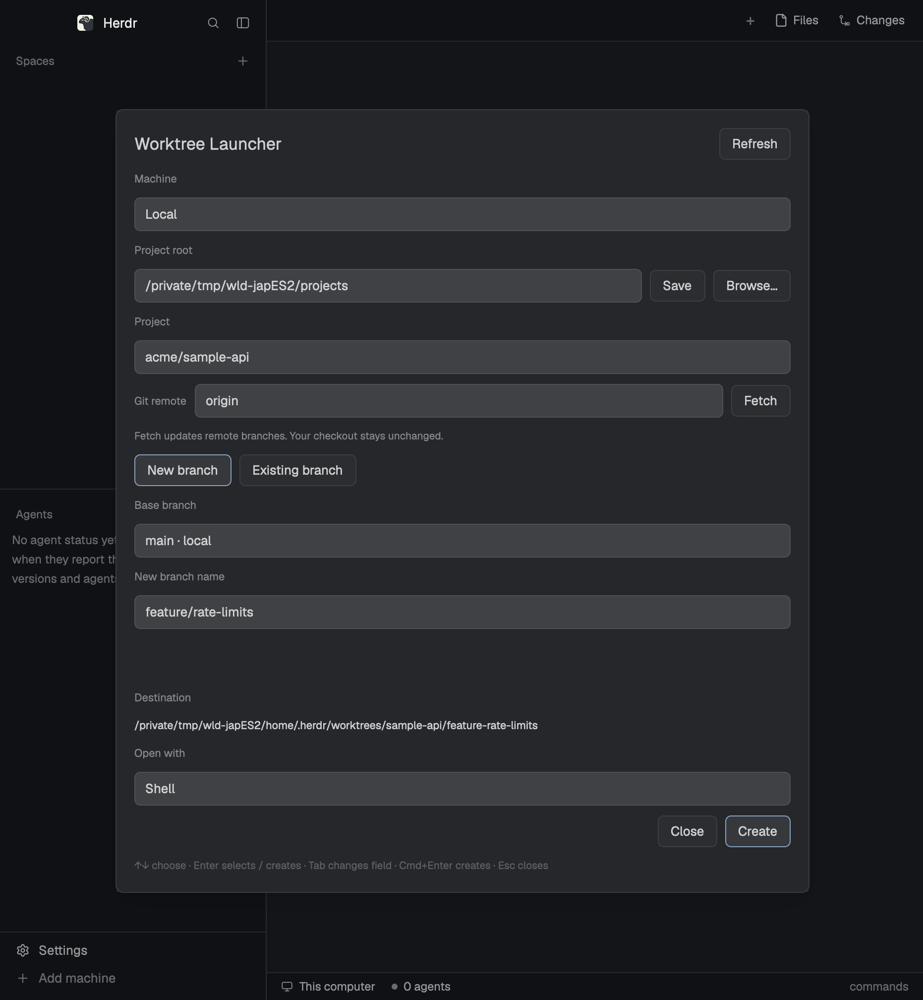
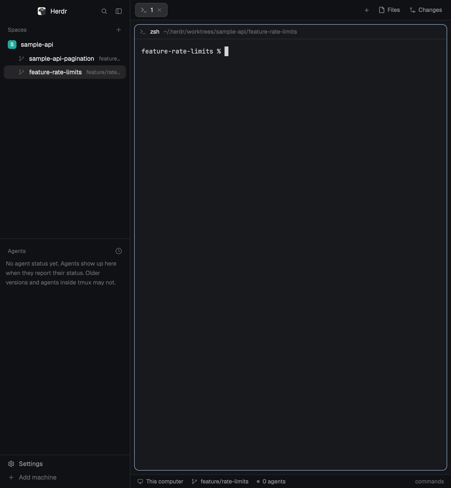

# Worktree Launcher

Create Git worktrees or start a fresh session in an existing checkout, without leaving Herdr.

Choose a project, select a branch, and open a shell or coding agent. Your primary checkout stays intact.

## Features

| Feature | What you can do |
| --- | --- |
| New branches | Select a local or fetched remote base and create a separate worktree. |
| Existing branches | Create a checkout for an available branch, or use its existing worktree folder. |
| Fetch remote branches | Fetch `origin` or another Git remote, then select new or updated branches without leaving the launcher. |
| Fresh sessions | Detect the worktree's existing Herdr space and open a new tab, or create a space. |
| Shells and agents | Start Shell, Claude Code, Pi, OpenCode, or Codex. Only agents detected on the selected machine appear. |
| Local and remote projects | Browse project folders and save a separate project root for each connected machine. |
| Native Herdr workflow | Keep worktrees grouped beneath their project, use keyboard controls, and follow Herdr's light or dark theme. |

If a created worktree's session fails to open, you can retry opening it without repeating Git creation.

## Install

You need:

- Herdr for macOS, with `herdr-app` and `hc` available in your terminal.
- Git and Bash on each machine that will contain worktrees.
- Node.js 24 or newer and pnpm 11.x for installation only.

Download or clone this repository. In your terminal, change into its directory, then run:

```sh
pnpm run install:mod
```

The installer copies the mod, checks it with your installed Herdr, and adds **⌘⇧G** (Command+Shift+G). It preserves existing settings and keybindings.

A dependency installation with `pnpm install` is not required.

If that shortcut is already assigned, use `pnpm run install:mod --no-shortcut`. You can open the launcher from your terminal:

```sh
herdr-app do mod.open --name worktree-launcher
```

The installed mod needs no Node process or additional mod. It was checked with Herdr app 0.1.13 and core 0.1.18.

### Choose a different shortcut

1. Open Herdr's `keys.json`, normally at `~/.config/herdr-app/keys.json`.
2. In `global`, add an unused key combination, such as **⌘⌥G** (Command+Option+G):

   ```json
   {
     "global": {
       "cmd-alt-g": "mod.open:worktree-launcher"
     }
   }
   ```

   Merge this entry into the existing `global` object. Keep the other bindings and sections.

3. If present, remove the old `"cmd-shift-g": "mod.open:worktree-launcher"` entry to replace the default shortcut.
4. Save the file, then press your new shortcut.

Herdr applies keybinding changes immediately. No restart is necessary. If you set `HERDR_APP_HOME`, edit `keys.json` in that directory instead.

Key names use `cmd`, `ctrl`, `alt` (Option), and `shift`, joined with hyphens. Bindings in `terminal` or `layout:<name>` override the same combination in `global`.

To install without the default shortcut, use `pnpm run install:mod --no-shortcut`. For later updates, use:

```sh
pnpm run install:mod --update --no-shortcut
```

This preserves your custom binding and prevents the installer from adding **⌘⇧G** again.

## Create your first worktree

1. Press **⌘⇧G**, or your custom shortcut, to open **Worktree Launcher**.
2. Select **Local** or a connected machine.
3. Use **Browse…** to choose the directory that contains your projects.
4. Select **Save**.
5. Search for your project and select it.
6. Optional: [fetch remote branches](#fetch-the-latest-remote-branches) to update the available choices.
7. Select **New branch**.
8. Select a **Base branch**.
9. Enter a **New branch name**, such as `feature/rate-limits`.
10. Keep **Open with** set to **Shell**, or select an available agent.
11. Check the destination, then select **Create** or press **Enter**.

You can also enter an absolute project-root path directly. The launcher saves a separate root for each machine. The root field stays visible for later changes.



*Create a separate checkout from the selected base. The destination preview shows where it will live.*

### Use an existing branch

Select **Existing branch**, then choose a local or fetched remote branch. The branch-name field disappears.

If the branch already has a checkout, its folder appears in the picker and preview. Select **Open worktree** to open a session in that folder.

The launcher reuses the checkout without changing its files or branches. You can also use checked-out branches as bases for new branches.


*The picker shows existing checkout paths. Conflicting remote branch choices remain disabled, with an explanation.*

### Fetch the latest remote branches

If a branch exists on the remote but is missing from the picker, fetch that remote to load it.

After you select a project, the launcher shows **Git remote** and **Fetch**. It selects `origin` by default, or the first available remote.

1. Select the Git remote that you want to update.
2. Select **Fetch**.
3. Wait for **Fetching…** to finish.
4. Choose a branch from the refreshed **Base branch** or **Branch** picker.


*Fetch discovers `origin/feature/from-remote` in this sample repository. The branch exists only on the remote before the fetch.*

Fetch runs on the selected machine and preserves your checkout and uncommitted work. It does not pull or merge changes into your current branch.

To use the latest remote base, select a remote branch such as `origin/main`. If you select local `main`, the launcher uses its current local commit.

The launcher fetches only when you request it. Repositories without remotes keep these controls disabled.

### Start a fresh tab in an existing worktree

1. Select **Existing branch** and a branch with an existing checkout.
2. Check the **Existing worktree** folder.
3. Choose **Shell** or an available agent under **Open with**.
4. Select **Open worktree**, or press **Enter**.

The launcher automatically detects a matching Herdr space on the selected machine. If it finds one, it opens a **new tab** there. Otherwise, it creates a space.

Each launch starts a fresh shell or agent. Older tabs keep running. Retrying an interrupted opening can reuse the tab from that attempt.


*Reopening this worktree adds tab 2 to the existing session. Tab 1 keeps running in the same worktree.*

### Open a coding agent

**Open with** defaults to **Shell**. It also offers Claude Code, Pi, OpenCode, and Codex when Herdr detects them on the selected machine.

The selected agent starts in the worktree with its Herdr launch settings. The primary project keeps its existing terminals.


*This sample installation detects OpenCode and Codex. Your menu reflects the programs available on the selected machine.*

### Find the result

The launcher opens the worktree in a Herdr space and reuses the primary project space when available. Herdr's standard sidebar groups worktrees beneath their project.



*A worktree appears beneath its project. Its selected tab starts in the worktree folder.*

Worktrees go to `~/.herdr/worktrees/<repository-name>/<branch-slug>` on the selected machine. For example, `feature/rate-limits` becomes `sample-api/feature-rate-limits`.

The repository name comes from its `origin` URL, or its primary checkout folder when no origin exists. An occupied destination stops creation.

## Work on a remote machine

1. Add the machine in Herdr with **Add machine**.
2. Open Worktree Launcher.
3. Select the machine in **Machine**.
4. Use **Browse…** to list its directories, or enter an absolute remote path.
5. Select **Save**.

Project discovery, Git commands, worktrees, and agents all use the selected machine. Only the desktop app needs the mod. Remote machines need no Node installation.

## Keyboard controls

| Key | Action |
| --- | --- |
| ⌘⇧G (default) | Open the launcher |
| ↑ / ↓ | Move through an open choice list |
| Enter | Select an open choice, or create/open when the form is ready |
| Enter in Project root | Save the root |
| Enter on Fetch / ⌘Enter in Git remote | Fetch the selected remote |
| ⌘Enter | Create/open directly, or save when Project root has focus |
| Tab / Shift+Tab | Move between controls |
| Esc | Close the launcher when no operation is in progress |

The UI follows Herdr's light or dark theme, including system appearance when Herdr uses it. Destination paths and error messages support text selection.

## Update

From an updated copy of this repository, run:

```sh
pnpm run install:mod --update
```

If you use a custom shortcut, add `--no-shortcut` to preserve it without restoring the default binding.

Updates preserve saved roots and recovery records. Installation does not restart Herdr or its core.

## Need help?

- **No projects:** check the selected machine and root, then select **Refresh**.
- **Cannot read a local folder:** check Herdr's permissions in System Settings → Privacy & Security → Files and Folders.
- **Git succeeded but the space did not open:** select **Open created worktree** to retry without creating another checkout.

See [settings and troubleshooting](docs/worktree-launcher.md) for manual installation, recovery, and removal.

For contributors, see [development](docs/development.md) and the [validation report](docs/validation/worktree-launcher.md).

Screenshots use disposable sample projects in a separate Herdr installation. Only agents detected in that installation appear.

License: [MIT](LICENSE).
