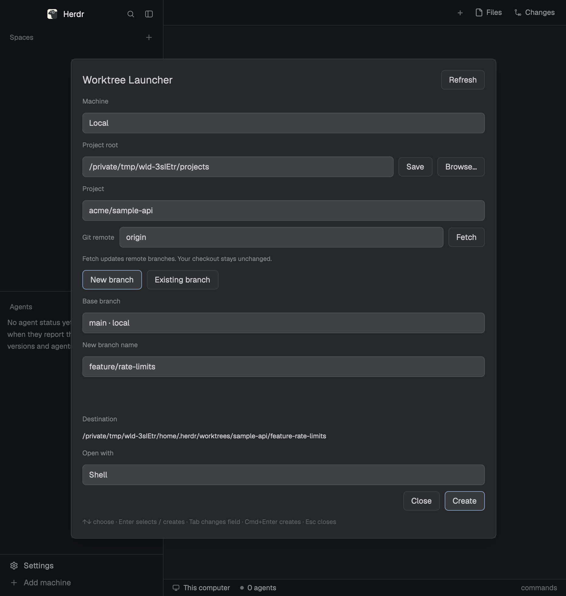

# Worktree Launcher

A native Herdr window for new and existing Git worktrees. Choose a project, optionally fetch a remote, and select a branch. Open a shell or an installed coding agent, with an optional initial prompt. The launcher uses local or connected machines and starts with the current space's project and branch.

## What you see

The launcher opens above the current Herdr window. It uses a 700 × 860 logical-pixel window with vertical scrolling for smaller screens. The title is **Worktree Launcher**, with **Refresh** on its right.

The form has these controls, from top to bottom:

1. **Machine**: Local and Herdr's connected machines.
2. **Project root**: a folder path, **Save**, and **Browse…**.
3. **Project**: a searchable repository picker.
4. **Git remote** and **Fetch**: visible after project selection, with a status message.
5. **New branch** and **Existing branch**: mutually exclusive actions.
6. **Base branch** or **Branch**: local and fetched remote refs, with existing checkout paths.
7. **New branch name**: visible only for a new branch.
8. **Destination** or **Existing worktree**: a selectable path preview.
9. **Open with**: Shell, then available Claude Code, Pi, OpenCode, and Codex commands.
10. **Initial prompt (optional)**: an 84-pixel multiline field, visible only for an agent.
11. Error or retry messages, then **Close** and **Create**, **Open worktree**, or **Open created worktree**.
12. A short keyboard hint at the bottom.

Use Herdr's theme colors for the background, text, borders, selection, focus, and errors. The view follows light and dark themes. Use 18-pixel outer padding, 10-pixel vertical gaps, 13-pixel body text, and a 17-pixel title. Inputs are 34 pixels high and buttons are 32 pixels high. Choice rows are 44 pixels high, with a list height of at most 220 pixels. An inactive or unfocused launcher dims to 85% opacity.

## How it behaves

- Opening activates the window and focuses the form. Startup shows **Loading current checkout…** and disables the form. Close and Esc remain available.
- The current checkout comes from the focused terminal, then the active tab's terminal, then the space's folder. Its machine, project, and branch become editable suggestions. Detached HEAD leaves the base unselected.
- Current-project startup resolves that checkout before any full project scan. Opening the Project picker loads and caches the project list. Without a usable checkout, the list loads for manual selection.
- Each machine has its own saved project root. Local browsing uses Herdr's folder picker. Remote browsing lists directories through the CLI. Save shows **Saving…** and disables other controls until completion.
- Fetch uses the selected remote, initially `origin` or the first remote. It updates available refs without switching the checkout. A valid branch selection and draft name remain intact. Fetch is disabled without a remote.
- New branch creates a branch from the selected local or remote base. Existing branch uses its checkout when available, or creates one through Worktrunk.
- Checked-out branches show their folders. Usable existing checkouts remain selectable. Invalid or unavailable checkouts explain why they cannot open.
- Open with defaults to Shell. Agent options reflect commands available on the selected machine. The prompt stays literal, including quotes, newlines, and leading dashes.
- A successful launch starts a fresh terminal. An exact checkout match reuses its Herdr space with a new tab. Otherwise, the launcher creates a space. Another checkout of the same repository stays separate.
- The standard Herdr sidebar nests worktree spaces beneath their primary checkout. The launcher creates a primary shell space if needed. It requires neither Paddock nor `spaces-grouped`.
- The launcher selects the resulting space and tab, focuses its terminal, and closes after confirmation. An opening error preserves the checkout and offers an in-window retry.
- Errors and destination paths support text selection. Focus uses the theme accent. Choice lists highlight the current row and dismiss on an outside click.

| Key | Action |
| --- | --- |
| Command+Shift+G | Open the launcher with the supplied shortcut snippet. |
| Tab / Shift+Tab | Move between controls. |
| Up / Down | Move through an open choice list. |
| Enter | Select a choice, or create/open when the form is ready. |
| Enter in Project root | Save the root. |
| Enter in Initial prompt | Add a new line. |
| Enter on Fetch / Command+Enter in Git remote | Fetch the selected remote. |
| Command+Enter | Create/open, or save with Project root focused. |
| Esc | Close outside an active operation. |

## Built from

This repository contains one desktop mod under `mods/worktree-launcher/`. It does not replace a layout or sidebar. The root `keys.json` is a mergeable shortcut snippet. The screenshot uses disposable sample repositories and Herdr's standard layout.

The mod consists of these files:

| File | Responsibility |
| --- | --- |
| `main.js` | Native view, controls, focus, keyboard handling, and current-space defaults. |
| `model.js` | Project and branch selection, loading, fetch, validation, creation, and opening. |
| `cli.js` | JSON API calls to the executable on the selected machine. |
| `config.js` | Saved roots for local and connected machines. |
| `journal.js` | Records for Git operations whose outcome needs inspection. |
| `mod.json` | Title, overlay size, and `place: none`. |

The remaining files provide the shortcut, example settings, and installed user guide.

The view uses `gpui-kit` and `gpui-base`, including `Input`, `Textarea`, `Popup`, and a virtual choice list. It uses `herdr` APIs for spaces, panes, focus, machines, known agents, folder selection, theme, file access, and commands. App commands select the resulting space, tab, and pane. Background work uses `cx.spawn` and native timers.

All repository and session operations use the standalone Go executable, `herdr-worktree-launcher`. The mod calls its `api --request <JSON>` interface through Herdr's `exec`, with the selected machine in `on`. The API covers context, discovery, directory listing, refs, remotes, fetch, programs, destinations, preparation, creation, inspection, and opening. The CLI itself operates only on its own machine.

The CLI uses Git, Worktrunk's `wt`, and Herdr Core's `hc`. Worktrunk creates checkouts with project hooks disabled. The CLI starts terminals through the core, labels them with space and tab IDs, and detects matching live checkouts. The UI passes a verified core ID. Standalone CLI commands require `HC_SOCKET` or `HC_SESSION`. Neither route starts a core.

Before installing the mod, install the CLI on each target machine. Follow the [README](README.md) or [package guide](docs/packages.md). The repository's `mise.toml` declares the source toolchain. Building the CLI requires Go. Its installed executable needs no Go or Node runtime. The supplied mod installer requires Node 24 or newer. pnpm is optional for that installer.

Project-scoped mise tools apply only inside this checkout. A runtime Worktrunk installation must remain available outside it, such as through `mise use --global worktrunk@latest` with shell activation. Git, Herdr.app, and `hc` use separate installers.

For a manual gallery installation:

1. Read the recipe and mod files before copying anything.
2. Install `herdr-worktree-launcher`, Git, `wt`, and `hc` on each target machine.
3. Copy `mods/worktree-launcher/` into the app home's `mods/` directory.
4. Preserve any existing mod with that name. Resolve the name conflict before installation.
5. Merge the root `keys.json` snippet into the user's keys. Ask before replacing an occupied shortcut.
6. Run `herdr-app check` on the installed mod folder.
7. Open the launcher and choose a project root in the UI.

The supplied installer also handles existing settings and shortcut conflicts. It is the normal installation route. Neither route needs a layout file.

## Watch out

- This mod runs programs and reads project files on the selected machine. Fetch and agent commands can use the network. It is trusted code.
- Copying JavaScript alone does not install the CLI. Missing executables or incompatible API versions produce an error before creation.
- Keep the CLI on the target machine's PATH. A remote target needs its own CLI, Git, Worktrunk, and `hc` installation.
- Use an already running core. Do not guess a core or start one as part of a launcher operation.
- Saved roots live in `<app-home>/data/worktree-launcher-config.json`. Paths are absolute. Saved settings do not expand `~` or environment variables.
- New checkouts default to `~/.herdr/worktrees/<repository-name>/<branch-slug>` on the selected machine. `HERDR_WORKTREE_ROOT` or CLI settings can select another root. Existing checkouts retain their folders.
- A repository's origin supplies its name. Without origin, the selected checkout's package or Python manifest can supply it. The folder name is the fallback.
- Unknown refs, duplicate branch names, and occupied destinations stop creation. The launcher never replaces unrelated files or removes branches and worktrees automatically.
- A Git record blocks only the same destination, or the same branch in the same repository, on the same machine. Confirmed Git creation clears the record before session startup. Later invocations are independent after a session-opening error.
- Closing the launcher does not roll back Git. A created checkout survives a failed session-opening attempt.
- The stock Codex command includes `--no-daemon`. Custom agent commands retain their configured arguments.
- Avoid concurrent edits to roots or keybindings during installation. Existing-file conflict checks and writes are separate, so another writer's changes can be lost.
- The preview demonstrates a sample installation. Available agents, branches, machines, and theme depend on the user's setup.

## Done when

1. The native module check passes without another desktop mod or custom layout.
2. The shortcut opens a focused launcher. Esc closes it before an operation starts.
3. A current Git checkout preselects its project and branch without scanning the full project root.
4. Opening the Project picker loads other projects without losing the current selection.
5. Saving a local or remote root preserves it after reopening and switching machines.
6. Fetch discovers a branch that previously existed only on the selected remote.
7. New branch creates the expected checkout and focuses a shell in it.
8. Existing branch preserves its checkout folder and starts a fresh terminal.
9. Reopening that checkout adds a tab to the same space. Another checkout stays separate.
10. Installed agents appear. Shell has no prompt field. An agent accepts a multiline prompt without submitting on plain Enter.
11. A session-opening error preserves the checkout. Retry opens it without repeating Git creation.
12. The view follows light and dark themes, and destination paths and errors support selection.

Use [the validation guide](docs/validation/worktree-launcher.md) for automated coverage and native acceptance procedures. CI uses control fixtures for UI tests. Native screenshots use an isolated Herdr installation with its standard sidebar.
